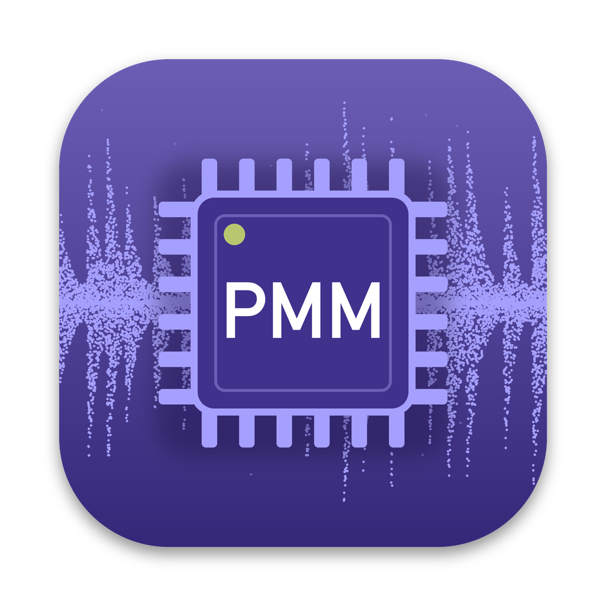

#  Perkons Mod Matrix Desktop

The [Mod Matrix](https://github.com/kiteless/perkons-re) for the Erica Synths Pērkons HD-01,
as a desktop app for Mac and Windows. Load your official firmware, tick the mods you want,
and get a modded firmware file to flash. Read each mod's user guide in the app, too. No Git,
Python, compiler or terminal needed.

**The Mod Matrix, perkons-re and the main mods are by [kiteless](https://github.com/kiteless).**
This app only packages them so they run without installing anything. It downloads the
newest Mod Matrix each time it starts, so you always get kiteless's latest version.

> Unofficial. Not affiliated with or endorsed by Erica Synths. Modded firmware is flashed
> entirely at your own risk. The app contains no Erica Synths firmware: you supply your own.

## Download

* **[Download for Mac](https://github.com/remixed123/modmatrix-desktop/releases/latest/download/ModMatrixDesktop-macOS.dmg)**: Apple Silicon (M1 or later),
  macOS 11 or later. Intel Macs are not supported.
* **[Download for Windows](https://github.com/remixed123/modmatrix-desktop/releases/latest/download/ModMatrixDesktop-Windows.zip)**: Windows 10 or 11, 64-bit.

Older versions: [all releases](https://github.com/remixed123/modmatrix-desktop/releases).

## Install

**Mac**

1. Open `ModMatrixDesktop-macOS.dmg` and drag **Perkons Mod Matrix Desktop** to **Applications**.
2. Open it from Applications. The first time, macOS asks whether to open an app downloaded
   from the internet: choose **Open**.

**Windows**

1. Right-click `ModMatrixDesktop-Windows.zip` and choose **Extract All**. Keep the extracted
   folder together: the app needs the files next to it.
2. Open the folder and run **Perkons Mod Matrix Desktop.exe**. The app isn't signed, so Windows may
   show "Windows protected your PC": click **More info**, then **Run anyway**.

The first start needs an internet connection: the app downloads the Mod Matrix and the
mods. After that it also starts offline, with the last version it downloaded.

## Use

You need the official Pērkons firmware **1.3.0** from Erica Synths
(`perkons_v1.3.0-0-force.img`) and the Pērkons's SD card.

1. **Load your firmware:** drop `perkons_v1.3.0-0-force.img` on the start screen, or click
   to choose it. Only an unmodified official image is accepted.
2. **Choose mod repos:** the mod collections to pick from. Only tick repos you trust. Press
   **CONTINUE**.
3. **Choose mods:** tick mods on the **MODS** tab; add voice engines on the **ENGINES** tab.
4. Press **PATCH IT** and wait about a minute.
5. Press **DOWNLOAD** and save the new `perkons_v1.3.0-0-force.img`.
6. **Flash it:** copy it to the root of the SD card (replace the old one), put the card in
   the Pērkons, hold all four voice trigger keys while powering on, and let go when the
   step LEDs start lighting.

kiteless's guide has the details: [building](https://github.com/kiteless/perkons-re#4-build-your-firmware),
[flashing](https://github.com/kiteless/perkons-re#5-flash-it), [using the mods](https://github.com/kiteless/perkons-re#6-use-the-mods) and
[going back to the official firmware](https://github.com/kiteless/perkons-re#going-back-to-the-official-firmware).

> A firmware file you build contains Erica Synths' firmware: it's for your own Pērkons,
> please don't share it.

## User guides

Every mod and engine has a user guide: what it does, its controls and how to use it on the
Pērkons. Read them in the app, before or after building, with no firmware loaded.

1. Click the **USER GUIDES** tab at the top of the window. **MOD MATRIX** takes you back to
   building; whatever you had loaded or ticked there stays as it was.
2. Pick a mod or engine on the left to show its guide on the right. The list holds the mods
   from every repo, A to Z, with each one's author and whether it's a **MOD** or an
   **ENGINE**.
3. Narrow the list with the search box (name, description or author; Enter opens the first
   match, Esc clears it), or show only **MODS** or **ENGINES**.

Links within a guide jump to its sections, and links to another mod open that mod's guide.
Other links open in your web browser; **View on GitHub** shows the guide in its repo.

* **PRINT** (top right of a guide) prints the whole guide, black on white, or saves it as a
  PDF from the print window.
* **COPY** copies the whole guide, to paste into a document, a note or a message with its
  headings and tables.
* To copy part of a guide, select it and **right-click > Copy** (or Cmd+C on a Mac, Ctrl+C on
  Windows). The right-click menu also has **Select all**, **Copy whole guide** and
  **Print guide**.
* **Refresh** (the round arrow next to the search box) gets the list and the guides again,
  for mods released since you opened the app. New ones are named under the search box. To
  build with a new mod, restart the app: the **MOD MATRIX** tab reads the list when the app
  starts.

Guides come from the mods' repos, so they're always the current ones. Each guide you open is
kept: offline, the app shows the copy from your last visit and says so.

## Updates

New mods, engines and features are added all the time. The app gets the newest Mod Matrix
and mod list each time it starts; if you keep it open, check for updates regularly: press
**CHECK FOR UPDATES** (top right; hold the pointer over it to see how long ago the Mod Matrix
started and when you last checked) to see what has changed since:

* **Mod Matrix**, or **new**, **removed** or **changed** mods (RAM figures, requirements): press
  **UPDATE NOW** to start the Mod Matrix again with them, without quitting the app. The
  firmware you loaded and the mods you ticked are cleared, so load your firmware again
  afterwards. Wait for a build in progress to finish first. **LATER** leaves things as they are.
* **Updated code** in a mod you can already pick: nothing to do, the next build uses it.
* **This app**: always shows the version you have; when a newer one is out, a button downloads
  it for your computer (Mac or Windows), with a link to what's new.

While the app stays open it also checks by itself, about once an hour while its window isn't
minimised. Nothing pops up; the button turns yellow instead, and stays yellow until you deal
with it:

* **UPDATES AVAILABLE** (solid yellow): something to update (UPDATE NOW) or a new version of
  the app to download. An update for the Mod Matrix stays until you press UPDATE NOW; a new
  app version clears with CLEAR.
* **UPDATES FOUND** (yellow outline): only mods' code changed; your next build uses it.
  Click it and CLEAR: the button clears until something new is found.

Hold the pointer over the button to see what was found; click it for the details.

## Help

* **Something went wrong:** the app writes a log, `launcher.log`, in its data folder:
  * Mac: `~/Library/Application Support/Perkons Mod Matrix/`
  * Windows: `%LOCALAPPDATA%\PerkonsModMatrix\`
* **Start afresh:** quit the app and delete that folder.
* **Uninstall:** delete the app (Mac) or the extracted folder (Windows), and the data folder.
* Problems with the app itself: [open an issue](https://github.com/remixed123/modmatrix-desktop/issues).
  Problems with a mod: its repo.

---

## Developer info

How the app works and how to build it, for those interested. You don't need any of this to
use the app.

### How it works

The app is a runtime and a small launcher. It holds:

* a standalone Python 3.12 with capstone and unicorn (what perkons-re needs),
* the Arm GNU Toolchain (arm-none-eabi), trimmed to the compiler, assembler, linker,
  objcopy, nm and objdump,
* the launcher (`launcher/modmatrix_launcher.py`, built with PyInstaller, window by pywebview).

It does not hold perkons-re or any mods. On each start the launcher downloads the newest
perkons-re (`main`) as a zip from GitHub, or uses the last one when offline, and starts its
Mod Matrix with the bundled Python and compiler. The Mod Matrix gets the mods itself, from
the repos in [repos.json](https://github.com/kiteless/perkons-re-mods/blob/main/repos.json).
The window shows the launcher's own page (`launcher/ui/`): the Mod Matrix in a frame on one
tab and the user guides on the other. The guides list comes from the Mod Matrix's mod list
(Refresh reads the repos again with perkons-re's own `perkons.repos`, run by the bundled Python);
each README is fetched from GitHub and rendered with marked and DOMPurify (both bundled).
CHECK FOR UPDATES compares perkons-re's and each mod repo's branch with the commit it was at
when the Mod Matrix started (git's ref list, no API limit; GitHub's compare API, one call per
changed repo, names the commits and the mods touched), and the Mod Matrix's mod list with the
repos read again; UPDATE NOW installs the newest perkons-re and restarts the Mod Matrix.
The automatic check (hourly, window in front) only reads the branches and the latest release
(a few small requests, no API calls); it reads the repos and asks the API only when something
is new, and compare answers are kept. `MODMATRIX_AUTO_CHECK_MINUTES` shortens its hour, to try it.
An update of perkons-re that needs other Python packages than the app holds is not used
(the app keeps the one it has and says so).

Everything downloaded or built goes in the data folder, never in the app:

* macOS: `~/Library/Application Support/Perkons Mod Matrix/`
* Windows: `%LOCALAPPDATA%\PerkonsModMatrix\`

with `framework/` (perkons-re), `cache/` (mods, measurements), `guides/` (the user guides
you've opened) and `launcher.log`. Deleting
it resets the app. Builds run in a temporary folder whose path has no spaces (perkons-re's
linker-map parsing needs that): `~/Library/Caches/PerkonsModMatrix/tmp` on macOS, the data
folder's short (8.3) path on Windows.

### Building

Everything the build downloads is pinned, with its SHA-256, in `runtime.lock.json`.

macOS (Apple Silicon):

```sh
scripts/build_macos.sh                         # -> dist/ModMatrixDesktop-macOS.dmg
SIGN_IDENTITY="Developer ID Application: Name (TEAMID)" NOTARY_PROFILE=notary scripts/build_macos.sh
```

Signing uses the hardened runtime on every binary; only the bundled Python has an
entitlement (`com.apple.security.cs.allow-jit`, for the emulator). Notarising needs a
notarytool keychain profile, made once with
`xcrun notarytool store-credentials notary --apple-id <id> --team-id <team> --password <app-specific password>`.

Windows (x64, unsigned for now):

```powershell
powershell -ExecutionPolicy Bypass -File scripts\build_windows.ps1   # -> dist\ModMatrixDesktop-Windows.zip
```

GitHub Actions (`.github/workflows/release.yml`) builds both; a `v*` tag makes a draft
release with the builds and the toolchain's GPL source. The macOS build goes into a release
only when it was signed and notarised (the secrets listed in the workflow).

Launcher tests: `build/venv/bin/python -m unittest discover -s tests`.

Options of the launcher (for development): `--browser` (no window), `--framework DIR`
(a local perkons-re), `--repos-url URL` (another mod repo list), `--runtime DIR`.

### Licences

The launcher and build scripts: MIT (`LICENSE`). Everything bundled: see `licenses/THIRD_PARTY.md`: the Arm GNU Toolchain is GPL-3.0 (its source is attached to
each release), unicorn is GPL-2.0, perkons-re is MIT, Python is under the PSF licence.
